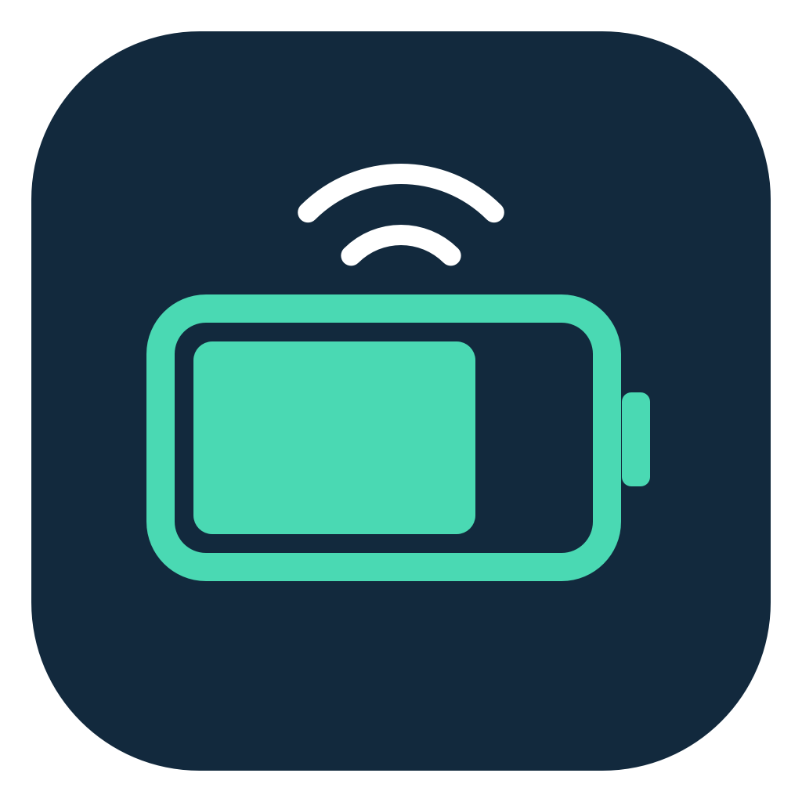

<p align="center"></p>

# BatteryBridge

让通过 **USB 2.4G 接收器**连接的无线键盘和鼠标，也能在 Mac 上直观看到电量。

🔋 **本工具主要解决 macOS 下 USB 2.4G 键盘、鼠标的系统电量接入问题，不是官方驱动的替代品。**

BatteryBridge 是一个轻量的 macOS 原生菜单栏应用：读取已适配外设的电量，以原生设备列表展示，并按用户选择发布到 macOS 的外设电源列表，供系统电池组件使用。

| 使用目的 | 对应工具 |
| --- | --- |
| 在 Mac 查看外设电量、选择接入系统电池组件、设置上报周期 | BatteryBridge |
| 修改 DPI、按键、宏、灯效、固件、配对及其他设备配置 | 对应品牌的官方驱动 / 网页驱动 |

🎯 BatteryBridge 专注电量桥接。可继续保留官方驱动；如双方同时访问接收器发生冲突，可关闭官方驱动后再读取电量。

> 当前版本：**0.5.8 Preview**。项目仍处于兼容性验证阶段，支持范围以本文列表为准。系统电池组件是否展示、采用何种图标，由 macOS 决定。

## 🔋 项目效果

- **原生设备列表**：采用 macOS 分组列表，每行展示设备图标、名称、电量、连接状态、充电状态和更新时间；右侧提供映射开关、刷新和更多操作。
- **充电状态**：区分“正在充电”“未充电”“未充电 · 已充满”；离线、过期或缺少有效标志时显示“充电状态未知”。系统发布同步包含正在充电 / 已充满 / 电源状态字段，系统组件决定具体显示样式。
- **可拉伸窗口**：设备行随窗口宽度伸缩，纵向空间不足时滚动；兼容始终显示滚动条的系统设置，并记住窗口位置和大小。
- **系统电量映射**：开启设备行右侧的映射开关或勾选菜单中的设备，将其电量发布到系统外设电源列表；取消勾选后移除对应发布记录。
- **版本可见**：菜单顶部、主窗口标题和菜单栏图标提示均显示当前运行版本，应用文件名保持 `BatteryBridge.app`。
- **原生菜单栏**：采用与当前 App 标志一致的单色模板图标，随 macOS 自动适配深浅背景。通过“显示主界面”打开设备列表，通过二级菜单选择设备、周期和登录自启。
- **设备操作**：通过每行的刷新按钮、更多按钮或右键菜单控制设备。已适配品牌可打开对应官方驱动；未连接的已保存设备可从更多或右键菜单删除。
- **通用设置**：自动更新提供 30 分钟、1 小时、2 小时、3 小时下拉选项，默认 1 小时，选择后立即生效并触发刷新；可切换“登录时启动”。
- **后台运行**：打开主窗口时显示 Dock 图标；点击关闭按钮后隐藏窗口和 Dock 图标，后台继续工作，可从菜单栏重新打开。退出程序使用菜单栏的“退出 BatteryBridge”。
- **开机自启**：一级菜单固定显示“开机自启”；二级菜单通过“开启 / 关闭”前的勾选表示状态，需要系统批准时显示批准入口。实际在当前用户登录后启动后台应用。
- **无需运行环境**：安装包内置原生程序，日常使用无需 Python、Node.js 或命令行。

下面是设备列表的信息示例，数字仅用于说明展示效果：

| 设备 | 电量 | 连接状态 |
| --- | --- | --- |
| G304 X LIGHTSPEED | 94% | 已连接 |
| MCHOSE K87 V3 | 92% | 已连接 |

### 是否依赖网页驱动？

**不依赖。** 安装并授权后，BatteryBridge 在本地直接通过 IOKit / USB HID 与已适配接收器通信，不需要保持浏览器、官网驱动页面或官方客户端运行，也不从网页缓存中取电量。网页驱动仅用于开发阶段确认协议，设备行中的“打开官方驱动”用于可选的设备配置。其他管理软件同时占用接口时，可能需要关闭后再读取。

### 电量读数与充电状态

YJX 本机实测回复的有效载荷为 `30 a5 95 2e 01 01 01 64 00 ...`：电量字段 `0x64` 等于 100，充电标志 `0x00` 表示未充电。这是接收器实际返回的数据，**不是模拟值或网页默认值**；百分比仍是设备固件给出的估算，无法据此保证电芯真实容量精度。

| 应用显示 | 有效读数要求 | 发送给 macOS 的状态 |
| --- | --- | --- |
| 正在充电 | 有效充电标志为是 | `Is Charging = true`、`Is Charged = false`、`AC Power` |
| 未充电 | 有效充电标志为否，未宣告已充满 | `Is Charging = false`、`Is Charged = false`、`Battery Power` |
| 未充电 · 已充满 | 有效读数表示已充满且不在充电 | `Is Charging = false`、`Is Charged = true`、`Battery Power` |
| 充电状态未知 | 离线、读数过期或没有有效充电标志 | 不编造充电状态；失效的系统发布按有效期规则撤回 |

状态来自设备支持的查询或主动上报，更新频率受所选周期和固件行为影响；可在设备行右键刷新。YJX 的“100% / 未充电”已在实机和系统电源列表中验证；“正在充电”的转换已用协议报文检查，本轮尚未实际插线验证。macOS 电池组件是否显示文字或闪电图标，由系统决定。

### 连接状态与电量更新

| 显示 | 含义 |
| --- | --- |
| 已连接 | 短时间内成功读取了设备信息和电量 |
| 接收器在线 | USB 接收器仍连接，设备的无线状态需通过后续查询确认 |
| 未连接 | 未检测到对应接收器 |
| — | 尚未取得有效电量，或上次读数已经过期 |

程序不会把无响应直接显示成 0%。上次有效读数保留一个上报周期加 3 分钟宽限；超过有效期后停止发布，避免长期显示失效数据。接收器移除后，会在下一次后台检查中清除对应电量。

## ⌨️ 兼容设备

### 当前已适配

| 品牌 | 型号 / 设备族 | 连接方式 | 当前验证范围 |
| --- | --- | --- | --- |
| Logitech / 罗技 | **G304 X LIGHTSPEED** | USB 2.4G 接收器 | 本机已观察到设备名称和电量进入系统电源列表；长时运行、登录 / 唤醒及跨固件回归仍待完成 |
| MCHOSE / 迈从 | **K87 V3** | USB 2.4G 接收器 | 本机已观察到设备名称和电量进入系统电源列表；长时运行、登录 / 唤醒及跨固件回归仍待完成 |
| Logitech / 罗技 | 提供 `0x1004` 或 `0x1000` 电量功能的部分 HID++ 2.0 键鼠 | 可访问相应厂商 HID 接口的 USB 接收器 | 已实现通用功能探测，属于实验性适配，需逐设备确认 |

**“已适配”不等于已完成所有系统版本、接收器版本和固件组合的测试。** 当前没有全品牌、全系列兼容承诺。

### 新增预览支持：狼蛛 AULA

| 型号 | 连接方式 | 实现与验证范围 |
| --- | --- | --- |
| **F75** | USB 2.4G 接收器 `3554:FA09` | 已实现报告 `0x13 / 0x4A` 电量读取、校验和验证和一次重试；本项目尚未实机验证 |
| **SC580（3311 / 3315 传感器版）** | USB 2.4G 接收器 `089D:062F` | 依据两个版本官方驱动实现 Feature `0x0F / 0x30` 状态读取，校验 M137 签名、序号和数值；本项目尚未实机验证 |

两款设备均接入自动更新、单设备刷新、系统电量映射和离线设备管理。
F75 接入充电线时，接收器可能固定返回 100%；这种回复不作为真实百分比，会清除原缓存和系统发布并提示切回 2.4G 刷新。
F75 的接收器标识属于共享固件家族，不能单凭该标识确定型号；不将 F75 Max、Pro 或 SC580 SE、Pro、Max 自动视为兼容。
实现依据、报文格式及实机验收步骤见 [AULA 适配说明](docs/AULA.md)。

### Logitech / 罗技：型号兼容列表

以下是 **BatteryBridge 的支持状态**。社区功能表只证明型号提供相应电量功能，不等于本项目已完成 Mac 接收器链路验证。实验性型号仍需同时满足：USB 2.4G 接收器可访问 `FF00:0001` 接口、可探测 `0x1000 / 0x1004`、能够取得设备名称 / 类型和有效百分比。

| 型号 | 电量功能依据 | BatteryBridge 状态 |
| --- | --- | --- |
| **G304 X LIGHTSPEED** | 已适配 HID++ 功能发现 | ✅ 本机已读取并发布系统电量 |
| G305（经典款） | 社区实机功能表含 `BATTERY STATUS 0x1000` | 🧪 通用探测已实现，本项目未实测 |
| MX Master 3 | 社区实机功能表含 `BATTERY STATUS 0x1000` | 🧪 通用探测已实现，本项目未实测 |
| MX Master 3S | 社区实机功能表含 `UNIFIED BATTERY 0x1004`，有 Bolt 接收器记录 | 🧪 通用探测已实现，本项目未实测 |
| MX Keys | 社区实机功能表含 `BATTERY STATUS 0x1000` | 🧪 通用探测已实现，本项目未实测 |
| MX Keys S | 社区实机功能表含 `UNIFIED BATTERY 0x1004`；部分来源为蓝牙连接 | 🧪 仅可作为协议候选，USB 接收器链路未实测 |
| MX Mechanical | 社区 Bolt 接收器记录含 `UNIFIED BATTERY 0x1004` | 🧪 通用探测已实现，本项目未实测 |
| 其他 Logitech HID++ 2.0 键鼠 | 运行时发现 `0x1000 / 0x1004` 后再判断 | 🧪 按设备能力探测，不能按品牌保证 |
| 只提供 HID++ 1.0、`0x1001` 电压或其他专有电量功能的型号 | 当前没有相应解析器 | ⛔ 暂不支持 |

经典 G304/G305 与 G304 X 不应混为同一实测型号。不同固件可能返回分档估计值，界面中的百分比不代表电池测量精度。

型号依据：[G305 功能表](https://github.com/pwr-Solaar/Solaar/issues/850)、[MX Master 3 功能表](https://github.com/pwr-Solaar/Solaar/issues/3002)、[MX Keys 功能表](https://github.com/pwr-Solaar/Solaar/issues/1569)、[MX Keys S 功能表](https://github.com/pwr-Solaar/Solaar/issues/3228)、[MX Mechanical / MX Master 3S 的 Bolt 记录](https://github.com/pwr-Solaar/Solaar/issues/3263)。

### MCHOSE / 迈从：型号兼容列表

迈从不同系列使用不同芯片 / 协议。**M HUB 官方支持的型号，不自动等于 BatteryBridge 支持的型号。**

| 型号 / 系列 | BatteryBridge 状态 | 说明 |
| --- | --- | --- |
| **K87 V3 · 2.4G** | ✅ 本机已读取并发布系统电量 | QHW `0x0904`；按接收器标识、产品名及厂商接口共同匹配 |
| G98 V3 | 🔎 待验证，当前未启用 | 官方网页驱动与 K87 V3 属于同一 QHW 分支；尚未确认实机回复 |
| K87 其他版本、K87S | ⛔ 当前未适配 | 不按相近型号名称继承 K87 V3 支持 |
| K99、G98 其他版本、G87、X75、GX87S、KX75、UT98、Z75S、G75 系列 | ⛔ 当前未适配 | 官方 M HUB 目录中有这些系列，但本项目未验证其电量协议 |
| A7、M7、L7、G7、G3、A5、AX5、K7 Ultra 鼠标系列 | ⛔ 当前未适配 | 不能复用 K87 V3 的键盘电量查询，也不能只按 VID / PID 套用 YJX 协议 |
| Ace、Jet、Mix 等磁轴键盘系列 | ⛔ 当前未适配 | 官方驱动支持不代表具备本项目需要的 2.4G 电量接口 |

官方型号目录：[MCHOSE M HUB Supported Devices](https://support.mchose.store/hc/en-us/articles/49078340935700-Getting-Started-with-MCHOSE-M-HUB)。上述未适配项表示当前构建范围，不表示设备硬件不能读取电量。

### 新增实验性接入：XUNSHE / YJX 接收器

| 项目 | 当前结果 |
| --- | --- |
| 官网网页 | 页面标题为 XUNSHE-M2；电量显示组件为空，但脚本保留电量与充电标志回调 |
| 本机接收器 | `A8A5:2255`，USB 产品字符串为 `USB Receiver` |
| 传输识别 | 结合实际 HID 描述符匹配 `0xAB` 输入与 `0xF0` 控制通道，不按 VID / PID 单独套用协议 |
| 已实现 | 持续监听厂商电量报文；按周期发送在线状态读取和有来源依据的 `0x30` 主动电量查询；校验后才显示和发布电量 |
| 本机实测 | 完全退出进程、针对准确安装路径重建授权并由访达启动后，运行时权限变为允许；接口打开和首次主动查询均成功，读取 **100%，未充电** |
| 系统接入 | 已观察到该鼠标的 100% 电量进入系统外设电源列表；长时运行、休眠 / 唤醒和其他固件仍待验证 |
| 型号显示 | 暂用“USB Receiver (YJX)”；网页标题不等于接收器返回的硬件型号 |

官方 XUNSHE 页面缺少电量显示内容，脚本也未提供主动电量查询方法；上一版只监听上报并读取在线状态，所以不主动推送电量的固件会一直显示 `—`。0.5.2 增加同平台开源实现已记录的主动读取：报告 ID `0xF0`、63 字节载荷、`0x30` 电量命令，最多尝试两次，并保留被动监听。本机现已收到 `0xF0 / 0x30` 的有效实机回复；其他 OEM 固件仍需分别验证。

**授权入口已修正**：此前键盘有电量会把主界面的授权按钮一起隐藏，导致鼠标权限问题不明显。现在只要任一在线设备被拒绝，就显示“授权读取”；对应设备行显示“需要输入监控授权”，右键也可选择“授权读取电量…”。系统设置的开关显示开启，不等于已运行进程立即获得许可。本机故障在彻底退出后、重新绑定准确安装路径并从访达启动后恢复，日志确认运行时授权允许，随后查询成功。操作顺序和准确应用路径需要一并核对；此前仅凭签名变化推断根因并不充分。预览版仍为 ad-hoc 签名，后续更新仍可能需要重新授权。 0.5.5 的充电状态解析、设备行显示与系统字段已通过自动检查；0.5.5 更新时曾出现上述授权失效，当时的重新授权复核尚未完成；0.5.8 尚未重新做此设备的实机验证。此前 0.5.4 的 100% / 未充电实机读数已验证，不能把它视为 0.5.5 更新后的验证结果。

其他同为 `A8A5:2255` 的设备可能使用不同报文。社区记录中的 G7 使用 `0x55 / 0xAA` 格式，与本机描述符和官方驱动不同，本构建没有向此接收器发送该查询，也没有将其命名为 G7。

### 待验证与暂不支持

只展示符合已适配接收器规则的 USB 2.4G 接口；普通有线 USB 键鼠、数位板及其他未知接口不会作为支持设备列出。

| 设备 / 类型 | 状态 |
| --- | --- |
| MCHOSE G98 V3 | 官方网页驱动与 K87 V3 使用同一 QHW 协议分支，具备复用依据；**当前构建尚未启用，未实机验证** |
| 其他迈从键盘、迈从鼠标 | 需要继续确认各型号电量协议，当前未列为支持设备 |
| Logitech HID++ 1.0、仅提供电压的设备、其他专用协议设备 | 当前未支持相应电量读取 |
| 其他品牌 USB 键鼠 | 未适配的接口不会作为支持设备展示或发送查询 |
| 蓝牙连接 | 当前不属于本项目的电量读取范围 |

### 为什么不能按品牌直接通用？

2.4G 描述的是无线连接方式，不是统一的电量协议。

- **罗技**：HID++ 2.0 提供设备功能表。程序先探测设备支持的电量功能，再选择查询方式；不同设备不一定支持同一项功能。
- **迈从**：同一个 M HUB 页面管理多个型号，内部仍存在不同协议分支。当前只对已确认的 K87 V3 型号启用查询。
- **USB 标识也可能复用**：K87 V3 和 G98 V3 的接收器可共用 `3837:1015`，必须结合产品名称等信息识别，不能仅凭 VID / PID 判断型号。

## 系统要求

| 项目 | 要求 |
| --- | --- |
| 系统 | 构建最低目标为 macOS 13；当前验证环境为 macOS 27，其他版本待进一步验证 |
| 架构 | 安装包包含 Apple Silicon（arm64）和 Intel（x86_64）通用二进制；Intel 实机仍待验证 |
| 外设 | 已适配的键盘 / 鼠标，并通过 USB 2.4G 接收器连接 |
| 权限 | 根据系统要求授予 BatteryBridge 输入监控权限；登录自启可能需要批准登录项 |

无需关闭 SIP，也无需安装内核扩展。

## 📦 安装方式

### 1. 安装应用

1. 下载项目提供的 `BatteryBridge-0.5.8-preview.dmg`。
2. 打开 DMG，将 `BatteryBridge.app` 拖入其中的 **应用程序（Applications）** 快捷方式；如果已有版本，选择替换。
3. 从 **访达 → 应用程序** 打开 BatteryBridge。

也可双击 DMG 内的应用并选择 **安装并启用**。有写入权限时会自动安装到相同的标准目录；若此 Mac 要求管理员权限，应用会提示改用访达拖入安装，由 macOS 处理授权。

应用统一安装到系统应用目录，方便在访达中管理：

```text
/Applications/BatteryBridge.app
```

部分 Mac 的系统应用目录需要管理员授权，以 macOS 提示为准。首次启动后，可通过菜单栏的“显示主界面”打开设备列表。

### 从旧版升级

新版固定覆盖 `/Applications/BatteryBridge.app`，不会创建带版本号的第二个已安装应用。内置安装器的暂存文件和回滚副本放在隐藏的 `.noindex` 目录，成功启动后清理；启动失败时尝试恢复旧版，回滚失败则保留恢复副本。

新版会识别旧版的 `~/Applications/BatteryBridge.app`。在标准目录的新版本启动时，会请求旧进程退出、更新自启注册，并将确认属于 BatteryBridge 的旧副本移到 `~/Library/Application Support/BatteryBridge/History.noindex/`，以 `.backup` 保存，避免留下废纸篓中的应用搜索项；原有映射选择、周期和自启偏好保留。若退出或迁移失败，旧副本保留，可稍后重试。移动应用或更新本地签名后，macOS 可能要求重新授予输入监控权限。

安装完成后推出 DMG。挂载中的安装盘仍包含一份应用，搜索结果刷新时间由 macOS 决定。构建和测试产物放在 `.noindex` 目录，不作为额外的日常安装副本使用。

### 2. 完成首次授权

如设备访问被拒绝：

1. 打开 **系统设置 → 隐私与安全性 → 输入监控**。
2. 允许 **BatteryBridge**。
3. 如果列表中没有应用，点击 `+`，选择安装后的 `BatteryBridge.app`。
4. 按 macOS 提示退出并重新打开应用，然后在对应设备列表上右键，选择 **刷新此设备电量**。

发布包使用 **ad-hoc 本地签名，尚未经过 Apple 公证**。首次打开可能需要用户通过 macOS 的系统流程确认；自签名不等于免确认安装。

### 3. 选择映射设备

打开主界面，开启设备行右侧的 **映射开关**；也可点击菜单栏图标，在 **映射设备**中勾选相应设备。

- 新发现的设备默认不映射。
- 已适配、可识别的设备可以勾选。
- 取消勾选后，程序在后台检查时注销该设备的系统电量记录。
- 应用内列表与系统电量映射独立：没有勾选的设备仍可在应用中查看已读取的数据。

### 4. 设置周期与自启

主界面下方的 **通用** 分组提供“自动更新”下拉选项与“登录时启动”开关；菜单栏也保留对应入口。更改周期后立即生效并请求新读数。

| 菜单 | 选项 |
| --- | --- |
| 上报周期 | 30 分钟 / 1 小时 / 2 小时 / 3 小时 |
| 开机自启 | 开启 / 关闭；二级菜单勾选当前选择，需要系统批准时提供跳转入口 |
| 显示主界面 | 打开设备列表窗口，位于“映射设备”上方 |

如果自启显示“待系统批准”，请通过菜单入口前往系统设置批准。

## 🖱️ 日常使用

关闭主窗口会同时隐藏 Dock 图标，后台程序继续运行。要停止程序，使用菜单栏的 **退出 BatteryBridge**。

点击设备行右侧“更多”按钮或在设备行上右键，可打开该设备自己的操作菜单；未适配的设备不能开启电量映射或发送电量查询。状态栏已移除“立即刷新电量”“设备电量…”和“输入监控设置…”三个入口；需要授权时，使用主界面的“授权读取”。

程序约每 10 秒检查接收器和映射选择。已支持主动查询的设备按所选周期读取电量；首次发现接收器、系统唤醒、权限恢复或手动刷新也会触发查询。实验性 YJX 接入同时监听厂商电量事件，并按周期发送已记录的主动电量查询；有效回复仍取决于设备 / 固件是否支持、是否醒着和接口是否可访问。

## 卸载

应用内不提供卸载入口。需要移除时，先在“开机自启”中选择“关闭”，再选择“退出 BatteryBridge”；然后在访达的“应用程序”中将 BatteryBridge 移到废纸篓。也可在 macOS 的“登录项与扩展”中管理登录项。

以下偏好设置和锁文件目录可能保留：

```text
~/Library/Preferences/local.batterybridge.agent.plist
~/Library/Application Support/BatteryBridge/
```

## 常见问题

### 设备能正常使用，为什么没有电量？

键鼠输入与电量查询是不同能力。请确认：设备采用 2.4G 接收器连接、型号在支持范围内、输入监控权限已允许，并且设备已唤醒。必要时关闭正在访问接收器的官方网页驱动或管理软件后重试。

### 应用内有电量，系统电池组件却没有？

先确认设备已在 **映射设备**中勾选。BatteryBridge 将数据发布到系统外设电源列表，系统组件是否显示、何时刷新及采用何种图标由 macOS 决定，仍需按系统版本验证。

### 电量为什么没有实时变化？

程序按所选周期更新；外设上报的百分比本身也可能是估算值。可选择更短的周期，或在设备行上右键选择 **刷新此设备电量**。

### “接收器在线”是否表示鼠标一定开着？

不一定。USB 接收器连接与无线外设醒着是两件事，因此程序会区分“已连接”和“接收器在线”。

## 🔒 隐私与实现边界

- 运行不依赖网络，不上传设备状态，不记录按键输入。
- 只发送已确认的电量、在线状态、设备名称和类型查询，不修改固件、配对、DPI、灯效或按键配置。
- 电量缓存保存在内存；本地偏好保存设备名称 / 标识、映射选择、周期和自启设置。
- 为排查 YJX 兼容性，本机 `~/Library/Application Support/BatteryBridge/diagnostics.json` 保存一份最新诊断快照，包含版本、接口错误、查询次数、最近电量报文前缀及当前设备状态；覆盖写入、不上传，不记录按键或鼠标轨迹。
- 使用 IOKit 私有 SPI 发布系统外设电源，未来 macOS 更新可能影响此能力。
- 图标使用 macOS 系统键盘 / 鼠标图形，不保证显示各型号的产品外观。

## 🛠️ 从源码构建

需要 Xcode Command Line Tools。在项目根目录运行：

```sh
./build.sh "$PWD/build.noindex"
```

输出位于 `build.noindex/BatteryBridge.app`。自定义输出目录如未处于 `.noindex` 目录下，脚本会自动追加 `.noindex` 后缀。构建脚本同时执行协议、周期有效期和原生菜单行为检查，另检查 8 组不同尺寸与滚动条组合，确认设备列表和操作按钮不横向溢出。

运行 `./release.sh` 构建 DMG，默认输出为 `release/BatteryBridge-0.5.8-preview.dmg`。项目约定最终安装包统一放入 `release/`，该目录已由 Git 忽略；临时打包文件使用 `release.noindex/`。打包暂存目录在完成或失败后自动清理，成功后也会移除构建用的应用副本，仅交付 DMG。单独运行 `build.sh` 时仍保留 `.noindex` 下的测试应用。源码包不包含构建产物。

诊断命令：

```sh
./build.noindex/BatteryBridge.app/Contents/MacOS/BatteryBridge --version
./build.noindex/BatteryBridge.app/Contents/MacOS/BatteryBridge --diagnose
```

终端与 GUI 应用的权限主体可能不同，请以安装后应用的结果为准。协议检查使用合成报文，不能代替真实设备测试。

README 顶部通过 `./docs/assets/logo.png` 引用项目内的 Logo。图片文件必须与 README 一起提交到 GitHub；仅提交 README 会造成图片缺失。该图片不在 Git 忽略范围内，打包时会校验引用存在，并在 DMG 和源码压缩包中保留同样的相对路径。

```sh
git add README.md docs/assets/logo.png
```

打包源码还包含项目约定 `AGENTS.md` 和 `.gitignore`；发布包不包含 `release/`、临时目录和其他构建产物。

## 0.5.8 Preview 更新

- 新增狼蛛 F75、SC580（3311 / 3315）2.4G 电量预览适配，实机验证待完成。
- 主界面采用 macOS 风格设备列表，设备行提供映射、刷新与更多操作，“通用”分组统一管理更新周期和登录启动。
- 排除未适配的普通 USB 接口，允许删除未连接的已保存设备。
- README 同步最新界面与兼容性范围，修复 Logo 资源交付；DMG 统一生成至 `release/`。

## 参与兼容性验证

提交 Issue 时，建议提供设备完整型号、接收器 VID / PID、macOS 版本、连接方式、官方驱动能否显示电量，以及 BatteryBridge 的表现。

请区分“名称已识别”“电量已读取”“系统映射已显示”，并避免公开设备序列号等个人信息。

## 参考资料

- [Logitech 官方 HID++ 2.0 文档](https://github.com/Logitech/cpg-docs/blob/master/hidpp20/README.rst)
- [MCHOSE 官方 M HUB 说明](https://support.mchose.store/hc/en-us/articles/49078340935700-Getting-Started-with-MCHOSE-M-HUB)
- [MCHOSE 官方网页驱动](https://www.mchose.com.cn/)
- [XUNSHE 官方网页驱动](https://xunshe.yjx2012.com/?productName=USB%20Receiver)
- [YJX F0 主动电量查询实现](https://github.com/mimuruu/EWEADN-GS02-Pro-Control)
- [YJX 不同固件报文的社区记录](https://github.com/HeyOkay/HaloBattery/blob/main/docs/protocols.md)
- [Solaar](https://github.com/pwr-Solaar/Solaar)

BatteryBridge 是独立项目，不是 Logitech、MCHOSE、XUNSHE 或 AULA 的官方驱动。
