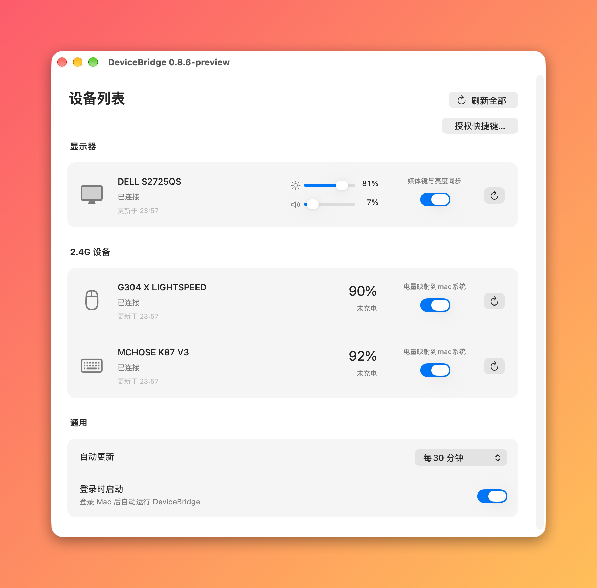
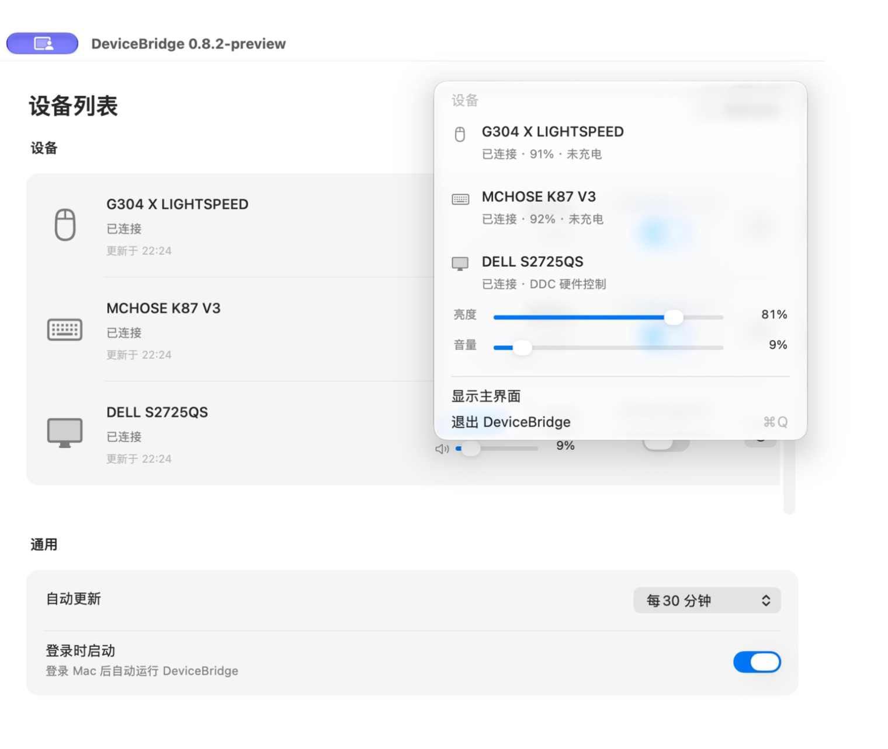
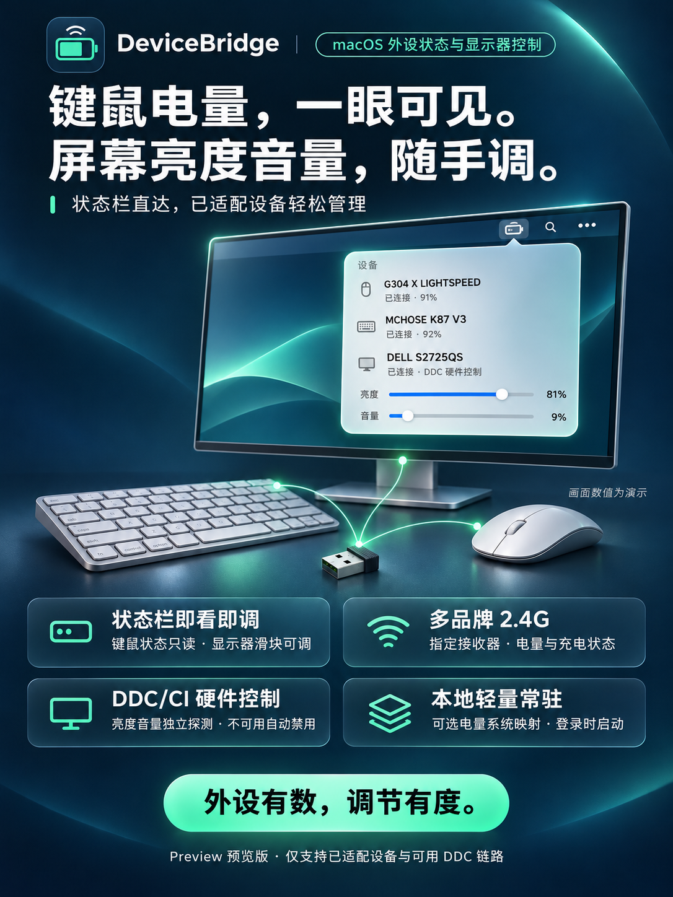

# DeviceBridge

项目仓库：[zjyg1993/devicebridge](https://github.com/zjyg1993/devicebridge)。

在 Mac 上查看 **USB 2.4G 无线键鼠电量**，并通过 **DDC/CI 控制外接显示器的亮度与音量**。

当前版本：**0.8.6 Preview**，仍在进行设备兼容性验证。

## 1. 能力价值

DeviceBridge 是轻量的 macOS 原生菜单栏应用，提供无线外设电量桥接与外接显示器 DDC 控制。

- **多品牌 2.4G 协议**：覆盖罗技、雷蛇、华硕 ROG、迈从、Pulsar、ATK / VXE、Corsair、LAMZU、WLmouse 等指定接收器；本轮按截至 2026-11-16 的公开产品及协议资料补充新款设备，具体范围见下表。
- **查看外设电量**：在设备列表中查看电量、连接状态和设备支持的充电状态。
- **接入系统电池组件**：按设备开启映射，将有效电量发布到 macOS 外设电源列表；组件是否展示、刷新时机与图标由系统决定。
- **自动更新与手动刷新**：支持 30 分钟、1 小时、2 小时、3 小时更新周期，也可单独刷新设备；无有效读数时不显示为 0%。
- **外接显示器控制（预览）**：扫描时自动读取型号，分别探测 DDC 硬件亮度、扬声器音量；采用与键鼠一致的设备行，提供亮度 / 音量滑块及独立映射开关；开启映射并授权后支持亮度键、音量键和静音键，插拔与唤醒后自动重查。
- **分类与整页滚动**：显示器独立分组并优先显示，2.4G 设备单独列出；从顶部标题到通用设置使用同一个滚动区域。
- **状态栏设备菜单**：显示器与 2.4G 键鼠分组，显示器优先。直接查看键鼠的电量、充电和连接状态；键鼠条目只读。外接显示器提供可调亮度、音量滑块，无有效读数、断开或写入失败时禁用对应调节。菜单调节不需要开启媒体键映射或授予辅助功能权限。
- **后台常驻**：支持登录时启动，关闭主窗口后继续运行，通过菜单栏管理和退出。
- **本地独立运行**：无需保持网页驱动或官方客户端运行，无需 Python、Node.js；不上传设备状态，不记录按键输入。

本工具不替代官方驱动的 DPI、按键、宏、灯效、配对或固件管理功能。

### 使用截图

**主界面：统一查看设备状态、设置电量映射，并调节显示器亮度与音量。**

**状态栏菜单：键鼠状态只读，显示器亮度与音量可直接调节。**

截图来自 0.8.2 的实际 AppKit 界面，设备和数值为文档演示数据。菜单使用同一套状态栏菜单，在预览窗口内展开以便完整截图；不表示已接入 macOS 原生控制中心。

查看宣传海报

## 2. 支持设备及型号

键鼠电量功能仅适用于已适配的 **USB 2.4G 接收器连接**。蓝牙、普通有线 USB 设备及未适配的接收器不在当前支持范围内。

| 品牌 | 型号 / 设备族 | 支持状态 |
| --- | --- | --- |
| Logitech / 罗技 | **G304 X LIGHTSPEED** | 已在本机读取电量并发布到系统电源列表 |
| MCHOSE / 迈从 | **K87 V3** | 已在本机读取电量并发布到系统电源列表 |
| XUNSHE / YJX | **USB Receiver（YJX）**，接收器 `A8A5:2255` | 实验性适配；此前版本已实测读取并发布电量，当前版本尚未重新实机验证；具体硬件型号未确认 |
| AULA / 狼蛛 | **F75**，接收器 `3554:FA09` | 预览适配，尚未实机验证；不包含 Max / Pro 等变体 |
| AULA / 狼蛛 | **SC580（3311 / 3315 传感器版）**，接收器 `089D:062F` | 预览适配，尚未实机验证；不包含 SE / Pro / Max 等变体 |
| Razer / 雷蛇 | **BlackWidow V3 Pro、V3 Mini HyperSpeed、V4 Mini HyperSpeed、V4 Tenkeyless HyperSpeed；DeathStalker V2 Pro / TKL** | 新增只读电量及充电状态，预览适配，尚未实机验证 |
| Razer / 雷蛇 | **Viper V2 / V3 / V4 Pro、Viper Mini Signature Edition；DeathAdder V3 Pro / V3 HyperSpeed / V4 Pro（含 Carbon Fiber）；Basilisk V3 Pro / 35K（含 Phantom Green）；Cobra Pro** | 新增指定 2.4G 接收器电量及充电状态，预览适配，尚未实机验证 |
| SteelSeries / 赛睿 | **Aerox 3 Wireless（含 CS2 Dragon Lore）、Aerox 5 Wireless（含 Destiny 2 / Diablo IV）、Aerox 9 Wireless（含 WoW）** | 新增接收器查询，5% 档位电量及充电标记；预览适配，尚未实机验证；不含 Gen 2 |
| Keychron | **M5、M6 8K，经 Ultra-Link 8K 接收器 `3434:D028`** | 新增电量及充电状态；显示设备族名称，预览适配，尚未实机验证 |
| Glorious | **Model O Wireless**，接收器 `258A:2022` | 新增在线电量查询，预览适配，尚未实机验证；充电离开无线链路时不提供当前读数 |
| ASUS ROG | **Harpe II Ace / Harpe II Extreme**，专用 SpeedNova 8K 接收器 `0B05:1AD0` | 新增指定接收器电量及充电查询，预览适配，尚未实机验证 |
| ASUS ROG | **Azoth、Azoth Extreme / Special Edition、Azoth 96 HE / Lite、Azoth X、Falcata、Strix Scope II 96 Wireless、Strix Morph 96 Wireless**，经 **OMNI 接收器 `0B05:1ACE`** | 新增配对型号识别与键盘电量路由，预览适配；仅命中已知配对型号才查询，尚未实机验证；不等同于各型号专用接收器均兼容 |
| MCHOSE / 迈从 | **A7 V2 Ultra**；**L7 / M7 接收器族（含 L7 Pro、M7 Ultra）**；**A5 Pro Max 1K / 4K 接收器** | 新增两类协议；共享接收器显示设备族，预览适配，尚未实机验证 |
| Pulsar | **X2 CrazyLight Mini**；**X2 V2 / X2H / X2A / Xlite V3 的指定 1K / 4K 接收器族** | 新增在线状态与电量查询，预览适配；不代表所有 CrazyLight 尺寸、SKU 均兼容，尚未实机验证 |
| ATK / VXE / VGN | **ATK X1 Pro 1K、Fire X 8K、VXE R1 SE+、R1 Pro Max、VGN Dragonfly 4K 接收器** | 新增 Compx 只读查询，预览适配，尚未实机验证 |
| ATK | **V75X 键盘**，`320F:5088` 且产品名 `ATK V75X 2.4G Dongle` | 新增键盘电量与充电状态，校验请求序号，预览适配，尚未实机验证 |
| Corsair | **SABRE v2 PRO ULTRALIGHT**，接收器 `1B1C:2B2A` | 新增 Compx 接收器协议，预览适配，尚未实机验证；不扩展到其他 iCUE / SLIPSTREAM 设备 |
| LAMZU / WLmouse | **Maya X 8K；Beast X、Beast X Max、Beast X Mini Pro** | 新增指定接收器 Feature 电量查询，预览适配，尚未实机验证 |
| Hitscan / Teevolution | **Hyperlight / Terra Pro** 的指定接收器 | 新增在线状态及电量查询，预览适配，尚未实机验证 |
| Logitech / 罗技 | **PRO X2 SUPERSTRIKE**，接收器 `046D:C54D` | 新增不依赖产品名的 HID++ 接收器识别入口；电量功能仍需实际探测与实机验证，尚不承诺兼容 |
| Logitech / 罗技 | 部分支持 HID++ 2.0 电量功能 `0x1000 / 0x1004` 的键鼠 | 已实现通用探测，需逐设备验证 USB 接收器链路 |

罗技其他在售系列（如 **PRO X SUPERLIGHT 2、G915 X LIGHTSPEED、G515 LIGHTSPEED、MX Master 4、MX Keys S**）作为通用 HID++ 路径的验证候选，未逐型号完成实机验证；接收器必须提供当前实现支持的电量与名称 / 类型功能。经典 G304 / G305 不等同于已实测的 G304 X。

**同品牌或相近型号不代表兼容。** 迈从 G98 V3 当前未启用，其他迈从型号须逐接收器核对；共享 USB 标识的接收器也可能使用不同协议。已实测设备仍需进一步验证长期运行、休眠唤醒及不同固件的表现。

新增型号按接收器 VID / PID、USB 接口或 HID 报文声明匹配，仅发送只读状态查询；休眠、无效或超时回复不伪造电量。上述预览适配已接入刷新和系统电量映射，并通过协议及路由测试，**仍需真实设备验证**。这是截至 2026-11-16 的实现范围，不是所有在售 2.4G 设备的全面兼容承诺。详细 USB ID、协议说明及未支持范围见 [2.4G 接收器适配说明](docs/WIRELESS-RECEIVERS.md)。

**当前主要缺口**：Keychron Q / V / K Max、Ultra 和 HE 键盘的原厂 2.4G 电量能力不能从鼠标协议推定；已有部分型号研究表明原厂接收器不转发电量查询，因此本版未启用，也不以使用时长估算代替真实电量。Corsair K65 PLUS / K70 无线键盘，以及雷柏、达尔优、黑爵等尚无本版适配的型号，仍在待适配范围。参见 [2026 年 11 月覆盖与缺口](docs/WIRELESS-RECEIVERS.md)。

适配细节：[AULA](docs/AULA.md) · [YJX / XUNSHE](docs/YJX-XUNSHE.md)。反馈兼容性问题时，请提供完整型号、接收器 VID / PID、macOS 版本及实际表现。

### 外接显示器

| 设备 | 支持状态 |
| --- | --- |
| **Dell S2725QS** | 用户已验证应用内亮度 `0x10` 和音量 `0x62` 控制；映射、插拔及唤醒持续验证中 |
| 通用 DDC/CI 显示器（不限品牌） | 按实际 VCP 响应分别探测亮度 `0x10`、音量 `0x62`；无需型号白名单，连接链路须支持 DDC |

**macOS 原生控制中心滑块尚未接入。** 当前提供应用内硬件调节与系统媒体键转发；MacBook 还可跟随已有的内建屏幕亮度滑块。Mac mini 没有内建屏幕，不能通过此同步方式新增原生亮度滑块；HDMI 音频无可写音量属性时，也不会因 DDC 自动获得系统音量滑块。详见 [显示器能力与验证说明](docs/DISPLAYS.md)。

## 3. 系统要求

| 项目 | 要求 |
| --- | --- |
| macOS | 最低构建目标为 macOS 13；当前验证环境为 macOS 27，其他版本待验证 |
| 处理器 | 包含 Apple Silicon（arm64）与 Intel（x86_64）通用二进制；Intel 实机待验证 |
| 外设 | 上述 2.4G 键鼠，或启用 DDC/CI 且连接链路支持 DDC 的外接显示器 |
| 权限 | 按系统提示允许输入监控；显示器媒体键转发需辅助功能权限；登录时启动可能需要批准登录项 |

打开 `DeviceBridge-0.8.6-preview.dmg`，将应用拖入 **应用程序**，再从访达启动。需要授权时，前往 **系统设置 → 隐私与安全性 → 输入监控** 允许 DeviceBridge，并按提示退出重开；随后开启设备行右侧的 **映射开关**，即可尝试接入系统电池组件。

预览版使用 ad-hoc 本地签名，尚未经过 Apple 公证，首次启动或更新后可能需要系统确认或重新授权。无需关闭 SIP 或安装内核扩展。系统电量发布使用 IOKit 私有 SPI，后续 macOS 更新可能影响兼容性。

更名后应用安装为 `/Applications/DeviceBridge.app`，安装包使用 `DeviceBridge-版本-preview.dmg`。为兼容升级，保留原内部应用标识和设置目录，已有映射、上报周期及自启选择继续使用；旧名称安装副本在新应用启动时归档。

源码仓库使用 `https://github.com/zjyg1993/devicebridge.git`。现有本地仓库可运行 `git remote set-url origin https://github.com/zjyg1993/devicebridge.git` 更新远程地址。

从源码构建需安装 Xcode Command Line Tools：`./build.sh "$PWD/build.noindex"`。运行 `./release.sh` 打包，仅将最终 DMG 输出到 `release/`（Git 忽略），不额外输出独立 App；临时打包文件使用 `release.noindex/`。

显示器请在 OSD 菜单中打开 **DDC/CI**，优先通过 HDMI / DisplayPort / USB-C 直连，点击“刷新全部”。有效读数出现后，设备行分别开放亮度和音量调节；开启该显示器的“媒体键与亮度同步”开关，再点击“授权快捷键…”允许辅助功能权限即可尝试使用媒体键。辅助功能已授权或媒体键监听已实际工作时，不再显示“授权快捷键…”；从系统设置返回时立即重新检测，撤销权限后按需重新显示。映射默认关闭，按显示器保存；关闭不影响应用内手动调节。显示器由自动发现维护，不提供右键删除，断开后保留状态。扫描不再清空设备行，暂时断开时保留“未连接”状态并禁用调节。部分 Mac HDMI 端口、扩展坞、KVM、DisplayLink 链路不透传 DDC；HDR 也可能锁定亮度。音量读取不可用时禁用音量滑块、音量键转发和静音转发，亮度独立判断。写入失败、回读失败或显示器未应用目标值时，停用对应功能；自动扫描不会解除写入失败状态，需点击刷新重新探测。扫描期间暂时禁用旧控件。读取失败显示不可用，不使用软件遮罩伪装硬件调节。

## 4. 参考资料

- [Dell S2725QS 官方手册入口](https://www.dell.com/support/product-details/en-us/product/s2725qs-monitor/resources/manuals)
- [ddcutil MCCS / VCP 功能说明](https://www.ddcutil.com/vcpinfo_output/)
- [MonitorControl：Apple Silicon DDC 实现与兼容性](https://github.com/MonitorControl/MonitorControl)
- [m1ddc：IOAVService DDC 工具](https://github.com/waydabber/m1ddc)
- [Logitech 官方 HID++ 2.0 文档](https://github.com/Logitech/cpg-docs/blob/master/hidpp20/README.rst)
- [Razer Viper V4 Pro 官方发布](https://www.razer.com/newsroom/product-news/viper-v4-pro-gigantus-v2-pro)
- [Corsair SABRE v2 PRO ULTRALIGHT 官方产品](https://www.corsair.com/ww/en/p/gaming-mouse/ch-931g000-ww/sabre-v2-pro-ultralight-wireless-gaming-mouse-ch-931g000-ww)
- [Pulsar 当前驱动与固件](https://www.pulsar.gg/pages/download)
- [MCHOSE 协议文档](https://github.com/alexfrih/mchose-linux/blob/main/PROTOCOL.md)
- [Pulsar / Compx 原始协议实现](https://github.com/andrewrabert/python-pulsar-mouse-tool)
- [G-Helper：ROG 外设实现](https://github.com/seerge/g-helper)
- [OpenRazer：雷蛇键鼠协议与设备目录](https://github.com/openrazer/openrazer)
- [Rivalcfg：赛睿设备与无线接收器目录](https://rivalcfg.flozz.org/devices.html)
- [alloyctl：Aerox 3 Wireless 协议](https://alloy.szymon-wilczek.me/protocol/steelseries-aerox3-wireless.html)
- [Keychron 电量协议实现](https://github.com/csutcliff/keychron-battery-dkms)
- [HaloBattery：多品牌电量协议记录（含 Glorious）](https://github.com/HeyOkay/HaloBattery/blob/main/docs/protocols.md)
- [Solaar：Logitech 设备协议与社区兼容性记录](https://github.com/pwr-Solaar/Solaar)
- [MCHOSE 官方 M HUB 说明](https://support.mchose.store/hc/en-us/articles/49078340935700-Getting-Started-with-MCHOSE-M-HUB)
- [MCHOSE 官方网页驱动](https://www.mchose.com.cn/)
- [XUNSHE 官方网页驱动](https://xunshe.yjx2012.com/?productName=USB%20Receiver)
- [YJX F0 主动电量查询实现](https://github.com/mimuruu/EWEADN-GS02-Pro-Control)
- [YJX 不同固件报文记录](https://github.com/HeyOkay/HaloBattery/blob/main/docs/protocols.md)

DeviceBridge 是独立项目，非上述品牌的官方驱动。

权限排查：macOS 27 的“设备控制和数据访问”对应旧版辅助功能权限。0.8.3 使用独立后台队列查询 IOKit PostEvent 授权，已授予时隐藏快捷键授权按钮；有效撤销 / 移除授权时停用监听，不以缓存的旧状态反复重启。若设置开关已开启但当前进程仍无权限，预览版更新的 ad-hoc 签名可能需要重新绑定系统权限；可运行 `/Applications/DeviceBridge.app/Contents/MacOS/DeviceBridge --diagnose-permissions` 检查当前应用路径、版本及权限结果（`0` 已授予，`1` 拒绝，`2` 未确定）。
